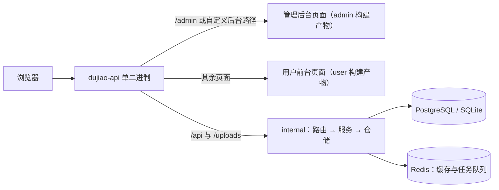

# dujiao-next

## 定位

独角数卡（Dujiao-Next）的 fork：一套发卡商城，后端 API、用户前台、管理后台在同一个仓，发布时编进同一个镜像，在 GoSail 的 K8s 集群上部署为 `store.gosail.tech`。上游是 `dujiao-next` 组织下的开源项目，本仓只在部署配置和确实要改的业务代码上和上游不同；上游的说明见 `README.md` 与 `admin/README.md`、`user/README.md`，原样保留。

## 目录地图

| 目录 | 职责 | 边界 |
|---|---|---|
| `cmd/server/` | 服务入口：读配置、迁移表结构、起 HTTP 与后台任务 | 只做装配，业务逻辑放 `internal/` |
| `internal/` | 后端全部业务：路由与处理器、服务层、数据模型与仓储、支付渠道、队列与后台任务、配置 | 只被 `cmd/` 引用 |
| `internal/web/` | 带 `fullstack` 构建标签时把两个前端的构建产物嵌进二进制并提供页面 | 不带这个标签时不嵌页面，二进制只有 API |
| `admin/` | 管理后台（Vue 3 + Vite），独立的前端包 | 只经 HTTP 调后端 API，不引用 Go 代码 |
| `user/` | 用户前台（Vue 3 + Vite），独立的前端包 | 同上 |
| `deploy/` | K8s 部署单元、发版前写版本号的脚本、机密对照表 | 只放部署配置，说明在 `fleet-doc/ops.md` |
| `.github/workflows/` | `docker-build.yml` 出测试版与正式版镜像；`release.yml` 是上游的 GoReleaser 发包 | 发版流程以 `fleet-doc/ops.md` 为准 |

## 大致架构

镜像构建时 `.github/workflows/docker-build.yml` 先分别构建 `admin/`、`user/`，把产物复制进 `internal/web/dist/`，再由 `Dockerfile` 用 `-tags release,fullstack` 编出一个二进制。管理后台的路径由配置项 `web.admin_path` 决定，不能和 `/api`、`/uploads`、`/health` 冲突（校验在 `internal/web/handler.go`）。配置读 `config.yml`，也可以用环境变量覆盖：配置项路径把 `.` 换成 `_` 再大写。

## 路由表

| 要改什么 | 先读 |
|---|---|
| 起服务、上游功能说明 | `README.md`、`admin/README.md`、`user/README.md` |
| 部署、发版、回滚、机密、上传文件卷 | `fleet-doc/ops.md` |
| 为什么这样定 | `fleet-doc/adr/README.md` |
