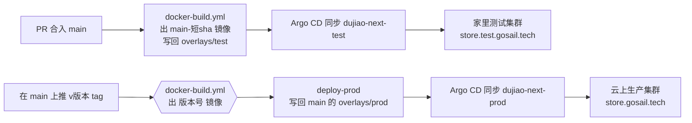

# 运维

> 独角数卡是一个单二进制的全栈服务：API、用户前台和管理后台的页面都编进同一个镜像。本文回答它在 GoSail 集群上部署在哪、配置在本仓哪个目录、测试版和正式版怎么发、怎么看状态和回滚。集群、共享 PG 与 Redis、Argo CD、入口这些各服务共用的环境，见 GoSail 工作空间仓的 `fleet-doc/ops.md`，这里不重复；集群拓扑与「Git 里写什么、线上就跑什么」的发布方式为什么这样定，见同仓的 `fleet-doc/adr/0005-k8s-single-prod-cluster.md`；生产为什么跟 `main`、正式版本为什么由 CI 构建完镜像后回写，见同仓的 `fleet-doc/adr/0008-prod-follows-main-ci-writes-version.md`。上游的通用安装说明见 [README.md](../README.md)，这里不重复。

## 部署在哪

| 环境 | 集群（kubeconfig 里的 context 名） | 命名空间 | Argo CD 应用名 | 跟本仓哪个分支 |
|----|----|----|----|----|
| 测试 | 家里的测试集群（`gosail-test`） | `dujiao-next` | `dujiao-next-test` | `main` |
| 生产 | 云上的生产集群（`gosail-prod`） | `dujiao-next` | `dujiao-next-prod` | `main` |

Argo CD 是装在生产集群里的部署工具，同时管着两个集群。它的每个「应用」（Application）记着一件事：从哪个仓、哪个分支、哪个目录取部署清单，部署到哪个集群的哪个命名空间；分支上的清单一变，它就把集群改成清单写的样子。两个应用都跟 `main`，区别在读的目录：测试读 `overlays/test`，生产读 `overlays/prod`。这两个应用的定义不在本仓，在 GoSail 工作空间仓的 `deploy/k8s/apps/overlays/test/services.yaml` 与 `deploy/k8s/apps/overlays/prod/services.yaml`。

两个应用都开着自动同步和自我修复：用 `kubectl edit`、`kubectl scale` 在集群里直接改的东西，会被 Argo CD 改回 Git 里的样子。要改部署，就改本仓 `deploy/` 下的文件并合进 `main`。

数据存在同一区域的共享 PG（`pg-cn`，由 CloudNativePG 管理）和共享 Redis 里，测试和生产各一个库、各一个只能访问自己库的账号、各用不同的 Redis 库号。上传的文件（商品图等）存在一块本地卷上，见〈上传文件〉。



## 配置在本仓哪里

部署清单按 kustomize 的写法分层：`base` 放两个环境共用的清单，`overlays/<环境>` 引用 `base`，只写这个环境不同的地方。

| 路径 | 管什么 |
|----|----|
| `deploy/k8s/dujiao-next/base/` | 两个环境共用：Deployment（镜像名、端口、探针、资源上限、凭证与连接串怎么拼）、Service、Ingress（生产域名）、上传目录的卷；ConfigMap `dujiao-next-env` 在这里写**生产**的库与 Redis 库号 |
| `deploy/k8s/dujiao-next/overlays/test/` | 测试环境：镜像版本、用 `behavior: merge` 把库名、账号、Redis 库号改成测试的值、测试域名 |
| `deploy/k8s/dujiao-next/overlays/prod/` | 生产环境：镜像版本、只调度到国内区域的节点 |
| `deploy/secrets-map.yaml` | 机密对照表，见〈机密〉 |

服务读配置的方式是环境变量：配置项路径把 `.` 换成 `_` 再大写，例如 `database.dsn` 对应 `DATABASE_DSN`（写在 `base/deployment.yaml` 的注释里）。端口、资源、库名、Redis 库号、镜像版本都以上面的文件为准，本文不抄。想看某个环境最终交给集群的完整清单，在仓根运行：

```bash
kubectl kustomize deploy/k8s/dujiao-next/overlays/prod
```

两个环境的镜像版本都由 CI 写回 `main`，不手改：`overlays/test` 在合并到 main 后写入，`overlays/prod` 在打正式 tag、镜像构建完之后写入。两边用同一个脚本 `.github/scripts/write-overlay.sh`。`overlays/prod/kustomization.yaml` 按 `kustomize edit` 的输出格式书写，CI 回写时只改 `newTag` 一行；手改它时保持这个格式，否则下一次回写会把整份文件重排一遍。

## 机密

凭证的值只存在本机 `settings.local.json`（默认路径 `~/.agents/settings.local.json`）的 `env` 下，Git 里只有键名。`deploy/secrets-map.yaml` 是对照表：集群里每个 Secret 的每个键，对应 settings 里哪个键。现在有这几个 Secret，键名以对照表为准：

| Secret（命名空间） | 用途 |
|----|----|
| `dujiao-next-secrets`（`dujiao-next`） | 库密码、Redis 密码、`APP_SECRET_KEY`、两个 JWT 密钥、初始管理员密码；生产另有 `WEB_ADMIN_PATH`（不易猜的管理后台路径，没配时是默认的 `/admin`）。测试与生产各一套 |
| `pg-cn-role-dujiao-test` / `pg-cn-role-dujiao-prod`（`data-cn`） | 数据库账号的密码，CloudNativePG 按它建账号；值与对应环境的库密码是同一个 settings 键 |

**生产的 `APP_SECRET_KEY` 不能换。** 它用来加密库里的敏感字段，换了已有数据就解不开。

推进集群用 GoSail 工作空间仓的脚本，在**工作空间仓根目录**运行：

```bash
# 先看会写哪些 Secret、哪些键（不打印值）
node deploy/scripts/secrets.js push --cluster test --map project/dujiao-next/deploy/secrets-map.yaml --dry-run
# 推测试集群 / 生产集群
node deploy/scripts/secrets.js push --cluster test --map project/dujiao-next/deploy/secrets-map.yaml
node deploy/scripts/secrets.js push --cluster prod --map project/dujiao-next/deploy/secrets-map.yaml
# 核对集群里的值与 settings 是否一致，只报一致与否
node deploy/scripts/secrets.js diff --cluster prod --map project/dujiao-next/deploy/secrets-map.yaml
```

脚本默认用 kubeconfig 里名为 `gosail-test` / `gosail-prod` 的 context，名字不同时加 `--context <名字>`。Argo CD 不管 Secret 的值，新增或修改凭证都要手动推。凭证在容器启动时读进环境变量，推完要重启一次：`kubectl --context gosail-prod -n dujiao-next rollout restart deploy/dujiao-next`。

## 发测试版

每次 push 到 `main` 都会发测试版，不用敲命令。`.github/workflows/docker-build.yml` 的做法：

1. 构建管理后台和用户前台，把产物嵌进 Go 二进制，打成镜像 `hubwu42/dujiao-next:main-<短 sha>` 推到 Docker Hub。这条流水线没有单独的测试或检查步骤，构建成功就发。
2. job `deploy-test` 把这个版本写进 `deploy/k8s/dujiao-next/overlays/test/kustomization.yaml`，以 `github-actions[bot]` 的身份提交回 `main`。这个提交不会再触发 workflow：用 GitHub Actions 自带的令牌推的提交，GitHub 不拿它触发任何 workflow。
3. 调 Argo CD 的 webhook，`dujiao-next-test` 立刻同步。仓库 secret `ARGOCD_WEBHOOK_SECRET` 缺了也不丢部署，Argo CD 每 3 分钟自己轮询一次 Git。

这条流水线不看这次改了哪些文件：只改文档或只改 `deploy/` 也会重新构建一次测试版。

## 发正式版

版本号用日期发布标识（`2026.10.24-r1`，按北京时间，同一天从 `r1` 递增）或 `1.2.3` 这种三段号。tag 写成 `v<版本>`，镜像和覆盖层里的版本不带 `v`。

在 `main` 上打 tag 并推送。**推正式 tag 就是上线确认**，生产没有其他人工审批，推之前由人确认：

```bash
git switch main && git pull
git tag v2026.10.24-r1
git push origin v2026.10.24-r1
```

tag 打在 `main` 的哪个提交上都行，包括 CI 回写测试版本号的那种提交。同一个 `docker-build.yml` 处理 tag：

| job | 干什么 |
|----|----|
| `meta` | 核对 tag 的格式，并核对它所在的提交在 `main` 的历史里；任何一条不对就整条停下 |
| `build` | 构建 `hubwu42/dujiao-next:<版本>` 并推到 Docker Hub，版本号同时作为 `APP_VERSION` 编进二进制 |
| `deploy-prod` | 镜像推成功后，把版本写进 `main` 上的 `overlays/prod/kustomization.yaml` 并提交，调 Argo CD 的 webhook；`dujiao-next-prod` 随即部署这个版本 |

镜像先构建好、才写进覆盖层，Argo CD 看到 `overlays/prod` 变化时镜像已经在 Docker Hub 上。所以 tag 所在提交里的 `overlays/prod` 还是上一个版本，生产实际在跑哪个版本，看 `main` 最新的 `overlays/prod`。

`deploy-prod` 和 `deploy-test` 都往 `main` 推提交，可能同时推。推送被拒的那一条会 rebase 到最新的 `main` 再推，最多试五次；两条改的是不同文件，rebase 不会冲突。

**干跑**：`v2026.10.24-r1-dry.1` 这种带 `-dry.N` 的 tag 只构建并推送带 `-dry.N` 的镜像，不写 `overlays/prod`，生产不变。

上游带来的 `.github/workflows/release.yml`（GoReleaser 出二进制包）已在 GitHub 上停用，推送 `v*` tag 不会触发它。

## 看部署状态

Argo CD 只装在生产集群里，两个环境的应用都在生产集群的 `argocd` 命名空间里看：

```bash
kubectl --context gosail-prod -n argocd get application dujiao-next-test dujiao-next-prod
```

`SYNC STATUS` 为 `Synced`、`HEALTH STATUS` 为 `Healthy` 就是上线完成。还想细看：

```bash
# 生产实际在跑的镜像、滚动进度、日志
kubectl --context gosail-prod -n dujiao-next get deploy dujiao-next -o jsonpath='{.spec.template.spec.containers[0].image}{"\n"}'
kubectl --context gosail-prod -n dujiao-next rollout status deploy/dujiao-next
kubectl --context gosail-prod -n dujiao-next logs deploy/dujiao-next --tail=100
# 测试环境的 Pod 在家里测试集群
kubectl --context gosail-test -n dujiao-next get pods
# 不想等 3 分钟的轮询，让 Argo CD 立刻重新读 Git
kubectl --context gosail-prod -n argocd annotate application dujiao-next-prod argocd.argoproj.io/refresh=normal --overwrite
```

也可以开 Argo CD 网页 <https://argocd-ui.gosail.tech>：只有连着 Tailscale 的设备能打开，用户名 `admin`，密码在 settings 的 `GOSAIL_ARGOCD_ADMIN_PASSWORD`。

存活检查：`curl -s https://store.gosail.tech/health`。

每次上线服务会短暂中断：上传目录的卷同一时间只能挂给一个 Pod，所以 Deployment 用 `Recreate`，先停旧的再起新的。服务启动时自动迁移表结构（`cmd/server/main.go` 调 `models.AutoMigrate`），迁移只往前走。

## 上传文件

商品图等上传文件存在 PVC `dujiao-next-uploads` 上（定义在 `base/uploads-pvc.yaml`），它用的是 local-path，也就是 Pod 所在节点的本地盘：

- Argo CD 对它设了永不修剪、永不删除，删掉 Deployment 或整个应用也不会带走它。
- Pod 被调度到别的节点时，这块盘上的文件不会跟过去。
- 这块卷现在没有备份。

## 回滚

### 测试环境

`docker-build.yml` 在每次 push 到 `main` 时都会重新构建并改写 `overlays/test`，手改 `overlays/test` 里的版本号会被紧接着的这次构建覆盖。所以测试环境只有一种回滚做法：开 PR 把出问题的改动 revert 掉，合入后自动发新的测试版。

### 生产环境

生产回滚有两种做法，都是生产操作，由人确认后再动手：

**常规做法：修好或 revert 之后发一个新版本。** 在 `main` 上 revert 出问题的改动，按〈发正式版〉用新的版本号再发一次，镜像从 revert 之后的代码重新构建。正式版本号不复用。

**紧急做法：手动触发 `docker-build.yml`，把上一个正式版本写回 `overlays/prod`。** 在 GitHub 的 Actions 页面选 `docker-build` → Run workflow，分支选 `main`，`tag` 填上一个正常的正式 tag；或者用命令行：

```bash
gh workflow run docker-build.yml -R HubWu42/dujiao-next --ref main -f tag=v2026.10.23-r1
```

`meta` 照样核对这个 tag 的格式、核对它在 `main` 上（只接受正式 tag，不接受干跑 tag），再看 Docker Hub 上有没有这个版本的镜像：有就跳过构建，`deploy-prod` 直接把版本写回 `overlays/prod`；没有就从 tag 所在的提交重新构建一次再写回。

退回之后：

- `main` 上的问题还在。修好之后照常发下一个版本，`deploy-prod` 会把 `overlays/prod` 改成新版本。
- 新版本启动时已经迁移过的表结构不会退回。先看两个版本之间 `internal/models/` 有没有变化，旧版本不能接受新表结构时只走常规做法。

## 访问地址

域名以 `deploy/k8s/dujiao-next/base/ingress.yaml`（生产）和 `overlays/test/kustomization.yaml` 里的 patch（测试）为准：

| 环境 | 地址 | 怎么访问 |
|----|----|----|
| 测试 | <https://store.test.gosail.tech> | 只有连着 Tailscale 的设备能访问：`*.test.gosail.tech` 解析到家里测试节点的 Tailscale 地址 |
| 生产 | <https://store.gosail.tech> | 公网；Cloudflare 灰云（只做解析、不经它的代理），直连国内入口 |

管理后台在同一个域名下：生产是 `WEB_ADMIN_PATH` 配的路径（值在 settings 里），测试没有配，是默认的 `/admin`。
